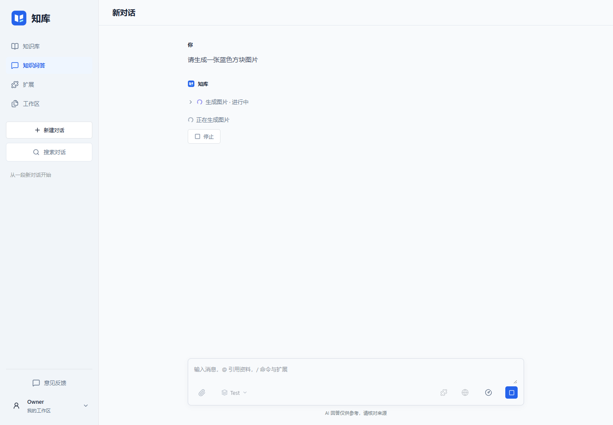
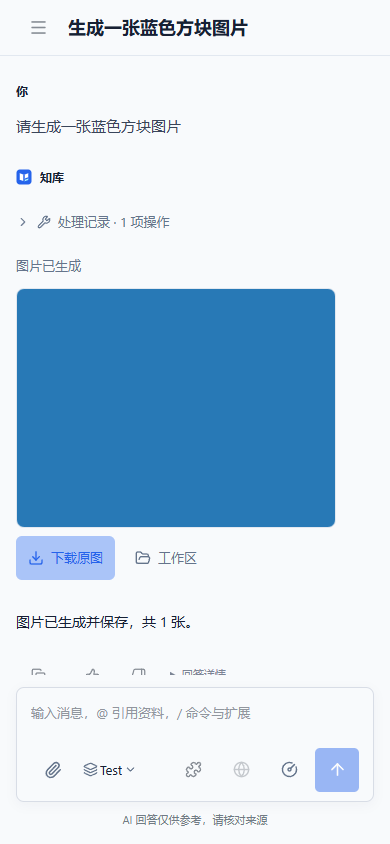
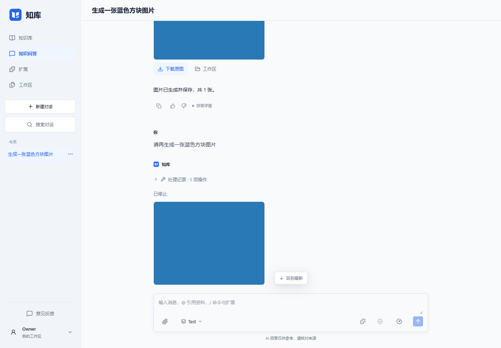

# Agent 云电脑与生图工具生命周期

关联 Issue：#105。

## 目标与边界

云电脑命令、文件操作、图片读取、预览启动和图片生成/编辑在当前 Agent 执行上下文中运行。后端等待真实业务结果，持久化回执后将结果交给模型继续任务。预览的完成条件是网页服务就绪。

外层会话仍使用 Celery；管理员图片测试、旧的未绑定后台任务和文档处理保持原执行入口。本次没有工具并行编排、全站队列替换或新的工作流引擎。

## 调用身份与结果

- `AgentToolExecution` 是调用身份。图片任务和云命令通过可空、唯一的 `agent_tool_execution_id` 关联它；管理员任务保持空值。
- 相同调用恢复时复用任务与回执；参数改变拒绝执行；不同调用即使参数相同也分别执行。
- 绑定任务只允许对应调用领取执行。状态 HTTP 查询、定时恢复和旧 Celery 投递不会重新提交绑定任务。
- 模型工具列表不再提供 `get_image_task`。界面状态接口保留，任务快照通过原来的 `tool_started` / `tool_result` 按 `call_id` 更新。
- 成功返回资源 ID、版本、路径和下载入口；部分成功、取消、失败、保存失败和结果不确定分别保留真实状态。排队或等待超时都不代表完成。

业务回执先于上下文窗口写入保存。停止或上下文拒绝追加时，已确认结果仍可恢复；停止后不会继续下一轮模型调用。

## 停止与恢复

停止回答会同时标记该请求绑定的图片和云命令取消。云命令在准备、提交和供应商查询边界检查停止；运行中的预览使用现有服务停止能力，无法确认时保留不确定状态。

生图提交前停止会释放预占；提交后供应商请求不能保证中止，后端仍接收、保存和按实际图片数量结算。迟到结果归属原回答，不附到新回答，也不启动新的模型回合。

浏览器刷新、断线或切换会话不结束外层执行。失去执行归属后，未提交任务取消；已提交命令和图片不重新提交。已持久化的图片只恢复保存。结果不确定时保留核对状态和账务预占，不能自动重新生成。

Issue #118 将环境管理退到后台：模型在临时任务完成且无后续用途时结束对应环境，
保留供用户交互的预览，不结束其他任务正在使用的环境。聊天只呈现任务与成果，
不列出环境状态或费用；预览提供对应环境的“结束运行”，用量在积分页只读查看。
生命周期、十分钟闲置和配置快照约定以 [云电脑文档](cloud-computer.md) 为准。

迁移 `0072_agent_tool_jobs` 只增加两个可空绑定及唯一约束，没有回填或旧任务重跑。执行 `alembic upgrade head` 即启用新路径，无额外开关。

## 聊天回合与采样恢复（#139）

浏览器使用 `request_id` 和事件游标接回原执行。过程说明、阶段性答复、最终答复与回合终态分别记录。补充文本以客户端消息 ID 去重，在完整模型步骤之间加入上下文。停止后仍可读取已接纳的消息和已确认的业务回执。

聊天 HTTP 首次失败后最多重试四次。每个模型步骤另有五次采样恢复，已确认的工具调用和结果保留在有效上下文里。每次独立采样分别记录已确认的用量。接不到首包时可以停止，流建立后按事件计算空闲时间，默认 300 秒。直连 OpenAI 的 Responses 路径尝试 WebSocket，同一轮保留路由标识，触发回退时用 HTTPS 继续。模型连接和浏览器连接各自报告可恢复状态。

迁移 `0077_tool_detail` 增加加密参数快照。展开操作详情时重新校验会话、执行、文档版本和资源权限，仅返回工具专用的展示内容。文件、图片和预览沿用现有资源入口。新回合从已保存的业务结果续接，结果待确认时查询原任务，保存失败仍从原任务重试保存。

## 自动验证

后端测试均使用模拟供应商：

```sh
cd backend
python -m pytest -q
```

PostgreSQL 并发与迁移测试仅接受数据库名以 `rag_auth_test_` 开头的独立测试数据库。先迁移测试数据库，再设置 `AUTH_TEST_DATABASE_URL`：

```sh
python -m pytest -q tests/test_image_tasks_postgres.py \
  tests/test_cloud_computer_postgres.py tests/test_context_windows_postgres.py \
  tests/test_knowledge_mentions_migration.py
```

`test_agent_inline_tools.py` 覆盖生成、编辑、停止竞态、权限撤销、保存恢复、回执恢复及完整的“生成 → 模型实际读图 → 写入报告 → 下载解析报告内图片”流程，并禁止调用工具子任务派发。完整流程还通过实际 Celery `solo` Worker（`concurrency=1`）执行生产会话任务入口，使用隔离的内存 broker/result backend；验证无需第二个 Worker 槽位。`test_cloud_tool_idempotency.py` 覆盖云命令恢复、冲突、启动结果不确定和预览停止。

```sh
cd frontend
npm test
npx tsc --noEmit
npm run build
```

## 浏览器验收

使用 `backend/tests/image_preview.py` 的合成模型、供应商和内存对象存储，外层执行池固定一个槽位。可通过 `PREVIEW_DATABASE_URL` 连接已迁移的独立 PostgreSQL 测试库，避免 SQLite 缺少行锁造成上下文初始化竞争；此入口仅为本地测试服务。

验收使用后端 `:8135` 和前端 `:3135`：

```sh
# 后端：配置 PREVIEW_DATABASE_URL、IMAGE_PREVIEW_HOST=0.0.0.0、
# IMAGE_PREVIEW_FRONTEND_URL=http://127.0.0.1:3135、
# IMAGE_PREVIEW_API_URL=http://127.0.0.1:8135，并将 8135 映射到 8128。
python backend/tests/image_preview.py

# 前端：NEXT_PUBLIC_API_URL=http://127.0.0.1:8135
npm --prefix frontend run build
npm --prefix frontend run start -- --port 3135

npx --yes --package @playwright/cli playwright-cli -s=issue105 open http://127.0.0.1:3135/
npx --yes --package @playwright/cli playwright-cli -s=issue105 run-code \
  --filename frontend/tests/browser/agent-inline.acceptance.js
```

脚本检查同一卡片进度、停止入口、刷新恢复、缩略图解码、原图下载、390px 布局、停止后的迟到成果归属及切换会话，同时检查浏览器异常和服务端错误响应。截图只含合成数据。







## 验收限制

本次不调用真实付费供应商。真实图片质量、云厂商网络与取消时序、供应商账单尚未验收。模拟模型证明资源与图像进入后续步骤，不代表已评估真实模型的文档质量。测试覆盖真实 Celery 单执行槽且禁止子派发；没有对 Redis broker 或生产 Celery 集群做负载测试。
