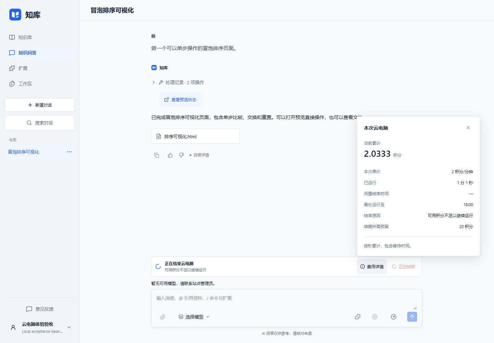
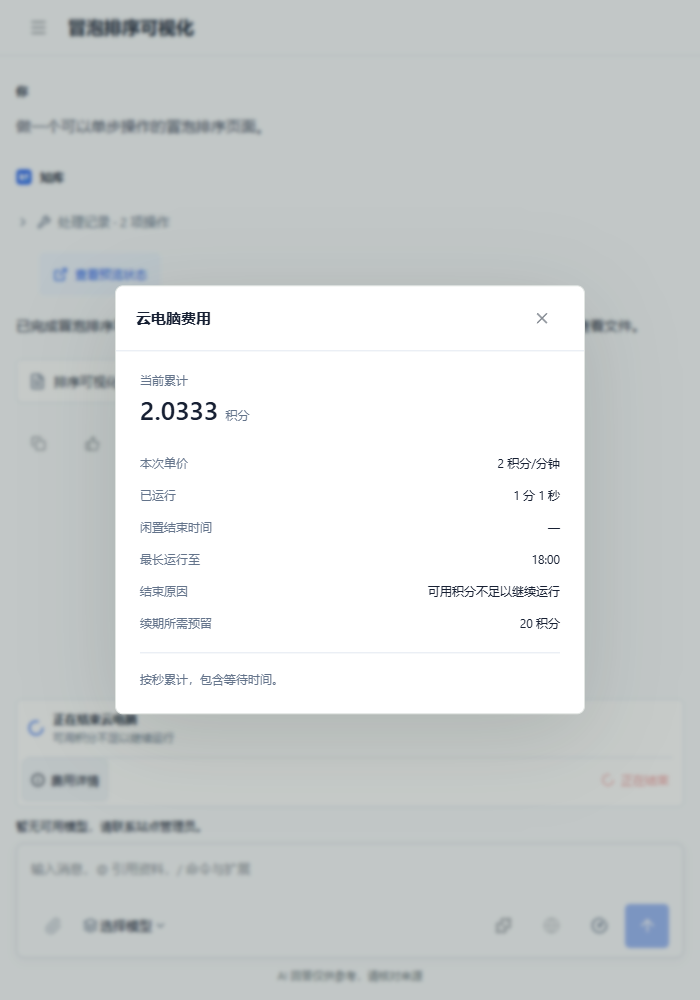
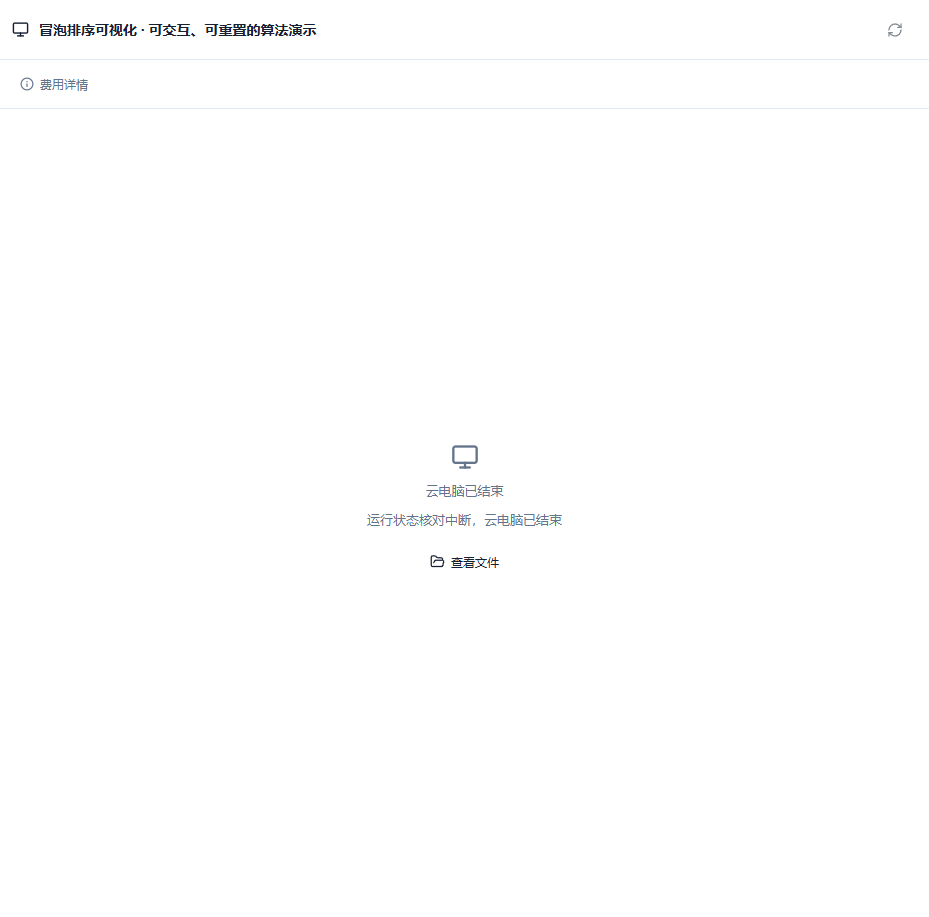

# 云电脑结束原因与状态修复

对应 Issue #114。基线为 `origin/main` 的 `51652282bb0c581f046efd21ee4688878cce0a1e`
（线上 v0.1.25），开发分支为 `codex/cloud-ending-reasons`。

## 目标与边界

修复余额充足时的“积分不足”误判，以及已经结束仍显示“正在结束”。
保留售价、完整闲置窗口预留、累计四位小数、计费上限和文件持久化规则。
延迟超过已授权费用范围时结束环境，不追收未覆盖费用、不自动重启。
本轮仅开发、本地验收和 PR，不合并或部署；多实例和完整恢复机制属于 Issue #112。

## 实现

- 结算返回明确枚举，分别表示继续、真实预留不足、预留覆盖耗尽和停止计费。
- 增加可空 `stop_reason`；条件更新只保留首次确定原因，清理和手动结束不覆盖已有原因。
- 供应商销毁未确认时仍为结束中；确认销毁或实例不存在后才展示最终状态、结算和文件入口。
- `summary` 只表达状态，不再使用内部 `error`；状态接口及预览中的环境对象增加
  `stop_reason`、`stop_reason_text`、`renewal_required_credits`，无新增公开接口。
- 真实预留不足才在费用详情展示续期所需积分；余额充足但核对中断单独说明。
- 聊天、内嵌及独立预览采用同一状态，迟到响应不抹掉原因，旧预览授权错误不遮住终态。
- 迁移 `0073_cloud_stop_reason` 只加字段，历史原因保持未知，不改变历史账务。
  旧应用可容忍新增可空列；应用回退无需数据库降级，不需重写用户数据。

## 本地验证

所有浏览器操作均访问 `localhost:3129` / `localhost:8129`，
使用独立 `cloud-114-acceptance` Docker 项目和合成用户、工作区、文件。
未加载线上密钥，未使用线上数据库或 OSS 目录。模型和沙箱供应商不调用付费接口，
供应商 IO 和预览 iframe 传输采用模拟；鉴权、状态、结束、结算和资源接口运行真实应用代码。
测试专用控制路由仅存在于 `cloud_ending_fixture`，不由正式 `app.main` 注册。

| 验证 | 结果 |
| --- | --- |
| 云电脑、结束原因、预览、挂载、文件工具及幂等相关回归 | 73 passed，1 skipped，1 deselected |
| 独立 PostgreSQL：原因并发、结束并发、结算幂等、迁移与历史账务 | 7 passed |
| 前端测试 | 46 passed |
| TypeScript、前端生产构建 | 通过 |
| Compose 配置、`git diff --check` | 通过 |
| 浏览器 1440 / 700 / 390px | 完成手动结束、销毁延迟、预留不足、预览交互、独立窗口及文件保留闭环 |

PostgreSQL 从空白测试库执行完整迁移后验证。迁移测试比较积分账户、账本、
用量及环境计费字段；原因竞争使用四个并发会话，结束与维护竞争确认只结算一次。
重复运行整组 PostgreSQL 测试需新建一次性测试库，避免旧准入测试留下的活跃环境占满并发名额。

浏览器检查键盘打开费用、Escape、焦点返回、44px 点击区域、reduced motion，
确认费用不持续读屏播报、未确认结束不出现最终消费、历史错误不覆盖终态。
补充状态接口失败保留上次数据，以及预览授权失败后仍正确进入终态的场景。
22 张截图保存在 `output/playwright/cloud114-*.png`，逐张审查；代表截图见下文。
测试控制端点可在本机连接重置时重试一次，仅用于合成场景复位，不改变业务请求重试策略。

## 已知限制

- 付费挂载测试因未开启真实付费验收而跳过，不将模拟供应商称为真实阿里沙箱验收。
- `test_image_and_preview_forward_stable_invocation_identity[read_image]`
  在未修改的 v0.1.25 镜像中同样失败：夹具 mock 读取 `chart.png` 成功，
  却未准备相应存储对象；后续真实文件链接核验返回 404，被包装为 `image_unavailable`。
  通过临时诊断插件取得该调用栈，已从上述通过集合中显式排除，未混入本次修复。
- 独立 UI 容器不启动付费任务 Worker；`/health` 的 Worker 未就绪是测试环境约束，
  不代表完成了生产全依赖健康验收。
- 本次没有部署，没有更改线上余额、账单、资源或历史错误文本。

## 重现方式

从仓库根目录使用 PowerShell：

```powershell
Push-Location frontend
npm ci --no-audit --no-fund
$env:NEXT_PUBLIC_API_URL = "http://localhost:8129"
npm test
npx tsc --noEmit
npm run build
Pop-Location
docker compose -f backend/tests/browser/compose.cloud-ending.yml up --build -d
docker compose -f backend/tests/browser/compose.cloud-ending.yml exec -T api alembic upgrade head
npx --yes --package @playwright/cli playwright-cli -s=cloud114 open http://localhost:3129/auth/login --headed
npx --yes --package @playwright/cli playwright-cli -s=cloud114 run-code --filename frontend/tests/browser/cloud-ending.acceptance.js
```

浏览器脚本使用合成用户登录，自动检查三个视口并保存截图。
PostgreSQL 仅使用以 `rag_auth_test_` 开头的新测试库，
通过 `AUTH_TEST_DATABASE_URL` 与 `MIGRATION_DATABASE_URL` 指向同一测试库：

```powershell
docker compose -f backend/tests/browser/compose.cloud-ending.yml exec -T api python -m pytest -q tests/test_cloud_ending_postgres.py tests/test_cloud_computer_postgres.py tests/test_cloud_preview_postgres.py
```

## 代表截图









